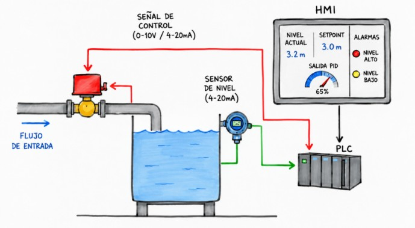
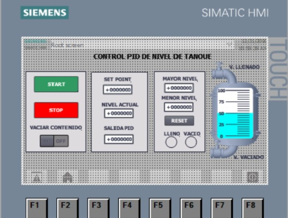
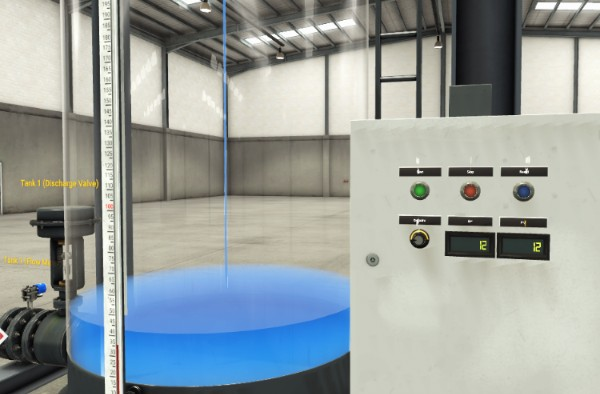
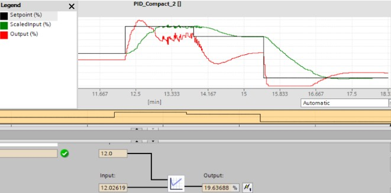

# Desarrollo y simulación de un sistema de control PID de nivel de tanque con Siemens S7-1200

## Descripción del proyecto

Este proyecto consiste en el desarrollo y la simulación de un sistema de control automático de nivel de líquido en un tanque, utilizando Siemens TIA Portal V16 para la programación del PLC S7-1200, una interfaz HMI para la supervisión del proceso y Factory I/O como entorno de simulación 3D.

El sistema emplea un controlador PID para regular una válvula de entrada de líquido y mantener el nivel del tanque alrededor de una consigna (*setpoint*), considerando las variaciones del consumo y las perturbaciones del proceso.

La integración de las herramientas de automatización y simulación permite evaluar el comportamiento del sistema de control, supervisar las variables del proceso y verificar la respuesta ante diferentes condiciones de operación, sin requerir una instalación física del proceso industrial.

<p align="center">
  
</p>

## Objetivos

- Desarrollar un sistema de control automático de nivel mediante un PLC Siemens S7-1200.
- Configurar un controlador PID en TIA Portal V16.
- Diseñar una interfaz HMI para la supervisión e interacción con el proceso.
- Integrar el sistema de control con una escena de Factory I/O.
- Evaluar el comportamiento del lazo de control ante cambios de consigna y perturbaciones.
- Configurar y verificar alarmas para condiciones de nivel alto y bajo.

## Tecnologías y herramientas

| Tecnología | Aplicación |
|---|---|
| Siemens TIA Portal V16 | Programación y configuración del sistema de control |
| Siemens S7-1200 | Controlador lógico programable considerado en el proyecto |
| HMI | Supervisión e interacción con las variables del proceso |
| Factory I/O | Simulación 3D del proceso industrial |
| Control PID | Regulación automática del nivel del tanque |

## Arquitectura del sistema

El sistema se organiza en tres componentes principales:

1. **Proceso simulado:** Factory I/O representa el tanque y la dinámica del proceso, incluyendo el flujo de entrada y las variaciones de consumo consideradas en la simulación.
2. **Controlador:** el programa desarrollado en TIA Portal ejecuta la lógica de control y el algoritmo PID para regular la válvula de entrada según el error entre la consigna y el nivel medido.
3. **Supervisión:** la interfaz HMI permite visualizar las variables relevantes, supervisar la salida del controlador e identificar las condiciones de alarma.

La comunicación y el intercambio de variables dependen de la configuración utilizada en el proyecto.

## Estrategia de control PID

El control se basa en la comparación continua entre el nivel deseado del tanque y el nivel medido durante la simulación. La diferencia entre ambos valores constituye el error que utiliza el controlador PID para calcular la acción de control.

La salida del controlador regula la apertura de la válvula de entrada, modificando el caudal suministrado al tanque para reducir el error y mantener el nivel alrededor de la consigna.

La respuesta del sistema depende de los parámetros del controlador, de las características del proceso simulado y de las perturbaciones aplicadas.


### Variables principales

- **Setpoint:** nivel deseado del tanque.
- **Nivel actual:** valor del nivel medido en el proceso simulado.
- **Error de control:** diferencia entre la consigna y el nivel actual.
- **Salida PID:** señal de control calculada por el controlador, expresada en porcentaje según la configuración implementada.
- **Válvula de entrada:** elemento de actuación que regula el ingreso de líquido.

## Interfaz HMI

La interfaz HMI permite supervisar el comportamiento del proceso y facilitar la interacción del operador con el sistema.

Las funciones consideradas en el proyecto incluyen:

- Visualización del nivel actual del tanque.
- Configuración y supervisión de la consigna.
- Visualización de la salida del controlador PID.
- Indicación de las condiciones de nivel alto y bajo.

<p align="center">
  
</p>

## Configuración de alarmas

Se consideran los siguientes umbrales de alarma para la supervisión del nivel:

| Alarma | Umbral |
|---|---:|
| Nivel alto | 4.5 m |
| Nivel bajo | 0.5 m |

Estos valores representan los umbrales definidos para el proyecto. Su funcionamiento se verifica durante la simulación, de acuerdo con la lógica de alarmas implementada.

## Simulación y evaluación

Factory I/O proporciona un entorno virtual para observar el comportamiento del proceso y evaluar la estrategia de control desarrollada.

Las pruebas se orientan a los siguientes aspectos:

- Regulación del nivel alrededor de la consigna.
- Respuesta del sistema ante cambios de consigna.
- Comportamiento frente a variaciones del consumo y otras perturbaciones consideradas.
- Supervisión de las variables del proceso desde la HMI.
- Verificación de las alarmas de nivel alto y bajo.

La evaluación permite analizar el comportamiento del sistema en las condiciones simuladas. Las conclusiones sobre estabilidad, rapidez de respuesta y desempeño deben sustentarse en las pruebas y evidencias obtenidas.

<p align="center">
  
</p>


<p align="center">
  
</p>

## Estructura del repositorio

```text
PROYECTO DE AUTOMATIZACION/
├── Factory_IO/
├── Tia_portal/
├── documentacion/
└── README.md
```

- `Factory_IO/`: archivos relacionados con la escena y la simulación del proceso.
- `Tia_portal/`: archivos del proyecto de automatización y configuración del PLC.
- `documentacion/`: documentos, capturas de pantalla y evidencias del proyecto.
- `README.md`: documentación general del proyecto.

## Requisitos de software

Para revisar o reproducir el proyecto, se requiere el software compatible con los archivos utilizados:

- Siemens TIA Portal V16.
- Factory I/O.
- Herramienta de simulación compatible con la configuración del PLC, si corresponde.

La ejecución depende de las versiones instaladas, de la configuración del controlador y de los parámetros de comunicación entre las herramientas.

## Procedimiento general de ejecución

1. Se abre el proyecto de automatización desde Siemens TIA Portal V16. (Para versiones posteriores se debe trasladar la logica ladder)
2. Se revisa la configuración del PLC, la lógica de control PID y las variables del proceso.
3. Se abre la escena correspondiente en Factory I/O.
4. Se verifica la configuración de comunicación entre el controlador o su simulador y Factory I/O.
5. Se inicia el entorno de simulación y ejecutar el programa de control.
6. Se supervisa el nivel del tanque, la consigna y la salida PID desde la HMI.
7. Se realiza las pruebas de operación y verificar las alarmas configuradas.

Los pasos específicos pueden variar según la configuración empleada para la simulación.

## Competencias aplicadas

- Automatización de procesos industriales.
- Programación y configuración de PLC Siemens S7-1200.
- Fundamentos de control automático y control PID.
- Desarrollo y supervisión mediante HMI.
- Integración de sistemas de control con entornos de simulación 3D.
- Supervisión de variables y configuración de alarmas.
- Evaluación del comportamiento de sistemas de control.

## Evidencias del proyecto

La carpeta `documentacion/` contiene los materiales de apoyo disponibles para revisar el desarrollo del proyecto.

- Vista general de la escena de Factory I/O.
- Captura de la interfaz HMI.
- Configuración del controlador PID en TIA Portal.
- Resultados del funcionamiento PID.
- Documento detallado del diseño.

## Alcance y limitaciones

El proyecto se centra en el desarrollo del programa de control y la evaluación del proceso en un entorno simulado. Los resultados corresponden a las condiciones configuradas en Factory I/O y no constituyen, por sí solos, una validación experimental de una instalación industrial real.

La implementación física puede ser realizada sin embargo quedan fuera del alcance de este proyecto.


**Autor:** Erick Isaias Huallanca Perez  
**Contacto:** [LinkedIn](https://www.linkedin.com/in/erick-isaias-huallanca-perez-925b7632b) | [huallanca999s@gmail.com](mailto:huallanca999s@gmail.com)

